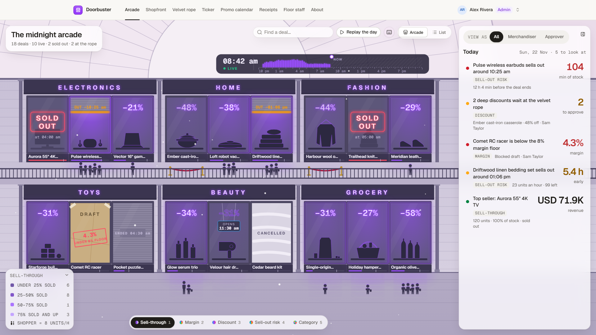

# Doorbuster

A deal desk for Cyber Monday, drawn as a **midnight arcade**. Plan deals with a **margin guard** that refuses to save
anything priced under the floor, send deep discounts to a **second person** before they go live, and watch every
deal's sell-through live with a **sell-out forecast**, so the hero product that runs out at nine in the morning is on
screen at seven.



## The problem

On Cyber Monday a retail team runs dozens of time-boxed deals. Someone sets a 60% discount that sells below cost, a
hero product sells out at 9 am with nobody noticing, and the promo calendar lives in a spreadsheet. Doorbuster puts
the three controls that prevent this in one place:

- **Margin floor.** Margin = (deal price − unit cost) ÷ deal price. Below **8%** the deal cannot be saved; a loss
  leader may go lower only when flagged with a reason of **20+ characters**, and always needs approval.
- **Four eyes on deep discounts.** A discount (1 − deal price ÷ list price) over **40%** needs approval by someone
  other than the deal's owner.
- **One deal per SKU at a time**, and a **sell-out forecast** from the last **2 hours** of sales.

It supports a pricing and approval process; it is not pricing, legal or financial advice (the About page says so).

## What it looks like

**The midnight arcade.** A two-floor shopping arcade at night under a glass fanlight: one storefront block per
category (electronics, home and fashion upstairs; toys, beauty and grocery at street level), one shop window per deal.
A window's **brightness is its sell-through** and a neon tube around it brightens as it sells; the **neon tag** in the
glass is the discount; a **queue of shoppers** outside is the last hour's sales (one per 8 units an hour, up to 7). A
sold-out window goes **dark under a SOLD OUT neon that strikes once**; a deal forecast to sell out before it ends gets
an **amber shutter** part-way down with the projected time on it and a blinking beacon. Deals waiting for approval
stand behind a **velvet rope**, drafts are papered over in kraft paper (a red stencil gives the margin when it is
under the floor), scheduled deals hang an "opens 14:00" card, ended deals pull the shutter down and cancelled ones
are whitewashed. The goods in each window are drawn in code from the deal's name, category and SKU, so the same deal
always looks the same. The wet street reflects the light; a little snow falls (capped, paused when the tab is hidden,
off with reduced motion).

- **The arcade clock** across the top: units sold per 15 minutes over the event's 24 hours. Drag it, use the arrow
  keys, or press **R** to replay the day from the sales ticks: windows light up, queues form, the TV goes dark.
- **Lenses** (keys 1–5): sell-through, margin (below floor, thin, healthy, rich), discount depth (light, mid, deep),
  sell-out risk (sold out, sells out early, short of target, on track, not selling), category.
- **View as** (V): all, merchandiser (your own deals; with none, the deals a merchandiser should act on) or approver
  (what waits at the rope). Everything else steps back.
- **Today**: three to five ranked items, each focusing its window and switching to its lens: deals that sell out
  within 2 hours, deep discounts at the rope, deals below the margin floor, a sent-back draft, an early sell-out, the
  top seller.
- **Tools, named in the metaphor:**
  - **Shopfront**: create or edit a deal with the margin guard live beside the form and a preview of the window it
    will light (papered over and stencilled when blocked, behind the rope when it needs approval).
  - **Velvet rope**: the approval queue. Terms, margin, profit at target, loss-leader reason, notes, approve or send
    back with a note. The owner sees "You own this deal" instead of the buttons.
  - **Ticker**: the live sales feed and every deal's sparkline with its projection; one deal in full with the
    forecast, the chart, terms, approval and notes. A **till simulator** appends sales every 5 s.
  - **Receipts**: CSV import of sales ticks (`sku,at,units,revenue`), every row checked on its own.
  - **Promo calendar**: every deal on its SKU's lane by category, event, week or all.
  - **Floor staff** (admins): merchandiser and approver roles.
- **Fallbacks:** the arcade is SVG (no WebGL; `?nowebgl` draws the same arcade), **L** switches to a sortable list of
  the same deals, reduced motion stops the flicker, blink, queue and snow and replays in hourly steps, `?` lists the
  shortcuts, and phones pan along the arcade under a pinned clock. Every screen in both themes, desktop and phone:
  [docs/redesign](docs/redesign).

## Prerequisites

- A Fabric tenant with the **Fabric Apps** workload enabled.
- A workspace on a Fabric capacity, and **Edit** (Contributor or higher) permission on it to deploy.
- Node.js 20 or later.
- Users need access to the app item (workspace members get it by default). SQL-only app, authenticated access only: no
  connector, no anonymous data access, no extra tenant setting.

## Run locally

```bash
npm install            # once, at the repository root
cd apps/doorbuster
npm run dev            # offline demo on http://localhost:5221 with seed data and a persona switcher
npm run dev:fabric     # rayfin dev: the real Rayfin backend and Fabric sign-in
SCREENSHOTS=1 npx playwright test e2e/screenshots.spec.ts   # rewrite docs/redesign/*.png
```

Demo personas (switch in the identity menu, or open with `?as=<sub>`):

| Persona | Sub | Role |
|---|---|---|
| Alex Rivera | `demo-admin-alex` | Admin: merchandiser and approver; owns the Harbour wool overcoat at the rope, so cannot approve it |
| Sam Taylor | `demo-merch-sam` | Merchandiser; owns the casserole at the rope and the blocked RC racer draft |
| Priya Nair | `demo-merch-priya` | Merchandiser; owns the earbuds that sell out within two hours |
| Jordan Lee | `demo-approver-jordan` | Approver |
| Chen Wei | `demo-viewer-chen` | Viewer |

## Deploy

```bash
npx rayfin login
npx rayfin up --workspace-id <workspace-id>
```

`rayfin up` builds the app (`build:fabric`), deploys it and applies the schema.

## Seed and making an admin

```bash
npm run seed:fabric -- --admin-email you@org.com
```

Inserts the demo data (skipped if the `seed:v1` marker exists). The event is a 24-hour Cyber Monday that opened ten
hours before the moment you seed, so it is always under way:

- **18 deals**, three per category, with **sales ticks every 15 minutes** generated deterministically from each
  deal's pace: **two sold out** (the TV before dawn, the beanie), **two sell out early** (the earbuds within two hours,
  the bedding later), **one below the margin floor** as a blocked draft (the RC racer at 4.3%, with a note on why), **two
  deep discounts at the velvet rope** (Sam's casserole, Alex's overcoat), an approved loss leader (olive oil), one
  scheduled, one ended on time, one cancelled.
- Approvals for the approved deep discounts, five notes, and the desk roles (Sam and Priya merchandisers, Jordan
  approver, granted by Alex).

The script maps the **first persona** (Alex Rivera) to the admin account you name. Open the deployed app once
**before** seeding so your Person row exists; the script also sets you as admin. By hand:

```sql
UPDATE dbo.People SET isAdmin = 1 WHERE email = 'you@org.com';
```

Grant merchandiser and approver roles to colleagues in **Floor staff**.

## How it works

### Entities

| Entity | Purpose | Key fields |
|---|---|---|
| `Deal` | One time-boxed deal: one window | name (3–80), sku (2–30), category (`electronics`, `home`, `fashion`, `toys`, `beauty`, `grocery`), listPrice, unitCost, dealPrice (decimal), stockUnits, targetUnits (int), startsAt, endsAt, status (`draft`, `pending`, `approved`, `live`, `ended`, `cancelled`), lossLeader, lossReason? (≤300), ownerSub, ownerName (≤100), submittedAt?, createdAt, updatedAt |
| `SaleTick` | Units sold in one interval, append-only | dealId, sku, at, units (int), revenue (decimal), source (`seed`, `import`, `simulator`), importedBy |
| `DealNote` | A note on a deal | dealId, authorSub, authorName, body (≤400), createdAt |
| `Approval` | One Velvet rope decision, append-only | dealId, dealOwnerSub (copied from the deal), approverSub, approverName, decision (`approved`, `sent_back`), termsKey, note? (≤400), decidedAt |
| `DeskRole` | Who may plan and who may approve | personSub, personName, role (`merchandiser`, `approver`), grantedBy, grantedAt |
| `Person`, `AppMarker` | Shared identity and seed marker | as generated |

Changes to the spec's model, for security: the spec's `approvedBy` / `approvedAt` on `Deal` became the append-only
`Approval` row (the deal's owner owns the deal row, so an approval stored on it would be writable by the owner). The
app shows "approved by" and "approved at" from that row. `lossLeader`/`lossReason` hold the loss-leader flag and reason,
`submittedAt` ties approvals to a submission, and `DeskRole` gives merchandiser and approver roles a home.

### Rules (pure functions in `src/domain/`, thresholds in `src/config.ts`, all unit-tested)

1. **Margin guard** (`pricing.ts`, `validate.ts`): margin below 8% blocks saving (draft or submit) with the computed
   margin in the message, unless flagged as a loss leader with a reason of 20+ characters. Exactly 8% passes (floating
   point noise is rounded away).
2. **Deep discount** (`pricing.ts`): over 40% off (strictly), or any loss leader, goes to `pending`. An approval is
   bound to a **terms key** (list price, unit cost, deal price, loss-leader flag): change any of them and the deal goes
   back to the rope; renaming it does not.
3. **No overlap** (`validate.ts`): two non-cancelled deals on the same SKU (case- and space-insensitive) cannot share
   time; back-to-back windows are fine.
4. **Sell-out forecast** (`forecast.ts`): units per hour over the last 2 h (or since the start, with at least 15
   minutes of selling) project when stock reaches zero. Before the end is the **early** warning; already at zero ends
   the window early (**sold out**); no recent sales is **stalled**; units projected by the end against the target
   give **short of target** or **on track**.
5. **Status follows time** (`status.ts`): the owner stores draft, pending, approved or cancelled. Approved comes from
   a valid approval; live and ended (and sold out) come from the clock and the sales, computed at any moment, which is
   also how the clock replays the day. A deep discount stored as `approved` without a valid approval is shown pending.
6. **Receipts** (`receipts.ts`): header `sku,at,units,revenue` in any column order; a row needs a known SKU, a time
   inside a non-draft, non-cancelled deal window and not in the future, whole units (1–10,000) and revenue ≥ 0
   (currency signs and thousands separators allowed), and a deal that is not waiting for approval; duplicates (same
   SKU, time and units) are skipped; at most 2,000 rows. Bad rows show their reason and the rest import.

### Security model

| Entity | read | create | update | delete |
|---|---|---|---|---|
| Deal | everyone signed in | `ownerSub = claims.sub` and status not `live`/`ended` | `ownerSub = claims.sub`; `ownerSub`, `createdAt` excluded | `ownerSub = claims.sub` |
| Approval | everyone | `approverSub = claims.sub` **and** `claims.sub ≠ dealOwnerSub` | nobody | nobody |
| SaleTick | everyone | `importedBy = claims.sub` | nobody | nobody |
| DealNote | everyone | `authorSub = claims.sub` | same | same |
| DeskRole | everyone | `grantedBy = claims.sub` | same | same |
| Person / AppMarker | as generated (isAdmin never writable from the client) | | | |

Enforced **by the database**: only a deal's owner can change or delete it and nobody can hand it to someone else;
nobody can create a deal already live or ended; approvals cannot be forged in someone else's name, edited or deleted,
and cannot be written by the person named as the deal's owner; sales history is append-only.

Enforced **in the domain** (`src/domain/*.ts`, in demo mode and in Fabric): the approver role (admins and
admin-granted approvers); that an approval counts only when its `dealOwnerSub` matches the deal, its approver is not
the owner, its terms key matches the current prices and it is newer than the last submission (so an owner who writes
an approval with a fake owner sub gains nothing); the margin guard, overlap rule and field limits; merchandiser-only
create, import and simulator; drafts-only delete; send-back notes; and that a role row counts only when an admin
granted it.

## Known limits

- **There is no admin claim**, so the database cannot tell an approver from anyone else: any signed-in user who does
  not own a deal can write an `Approval` row for it through the API. The app ignores approvals from people without the
  approver role (checked against admin-granted `DeskRole` rows). Database-level role checks need dynamic auth claims
  (`udf.authClaims`), listed under Later.
- The owner can write any stored `status` through the API; the effective status is computed (rule 5), so a deep
  discount marked `approved` without a valid approval still shows as pending.
- Receipts refuses rows for a deal that waits for approval, but `SaleTick` rows can be written through the API for any
  deal (stamped with the writer's sub). The arcade still shows an unapproved deal as pending.
- Sales ticks are trusted as the till reported them: an import can push a deal past its stock (shown as 100%, sold out).
- Everyone signed in can read deals, costs, margins and sales.
- Times are entered and shown in the viewer's time zone and stored in UTC; the event clock spans 24 hours from the
  first hour a current deal opens.
- Live screens poll every 5 s; there are no push updates.

## Later

- Stock top-ups as their own records, so a forecast can include incoming stock.
- A Function that pulls sales from the point-of-sale system on a schedule instead of CSV.
- Database-level role enforcement with `udf.authClaims`.
- Price history per SKU (was-price compliance for "x% off" claims).
- A wall-screen mode that cycles the arcade between lenses for the trading floor.

## Gallery

**Title:** 12 Days of Fabric Apps: Day 1 – Cyber Monday Deals

**Blurb (80 words):** Doorbuster is a Cyber Monday deal desk drawn as a midnight arcade. Every deal is a shop window
that glows brighter as it sells, with a queue outside sized by the last hour of sales. Sold-out windows go dark under a
neon sign; deals about to run out lower an amber shutter with the time on it. A margin guard blocks anything under the
floor, deep discounts wait behind a velvet rope for a second person, and the clock replays the whole day.

**Tags:** Partner | 12 Days of Fabric Apps · Fabric Apps · SQL database · Retail · Pricing · Approvals

Built by Datachain Consulting for AI at Work.
